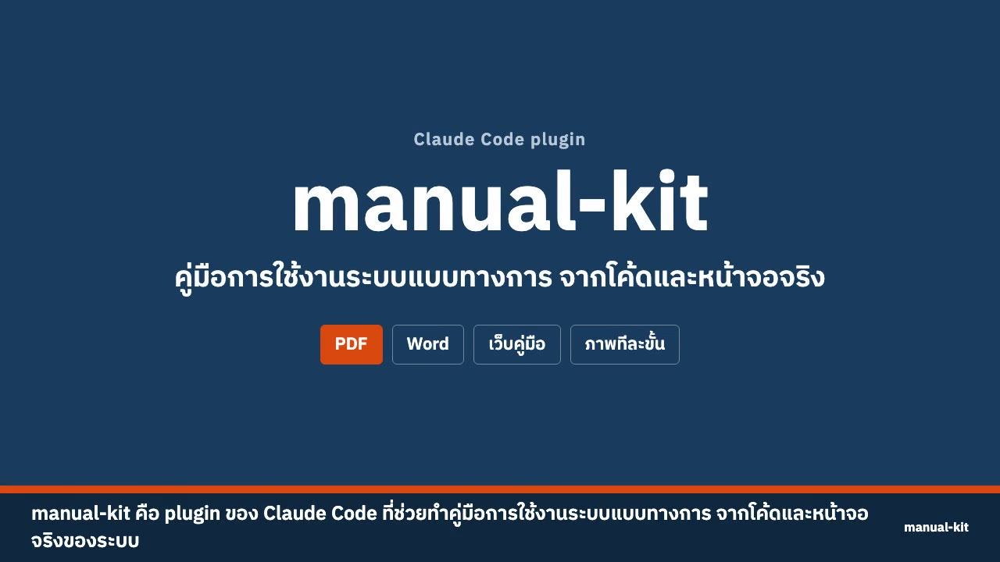
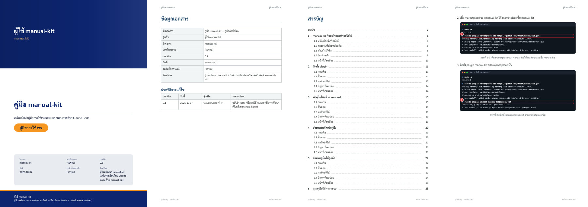
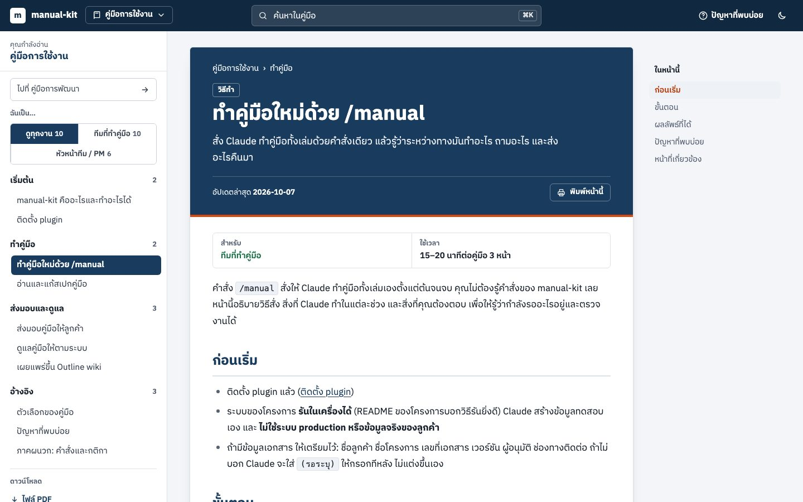
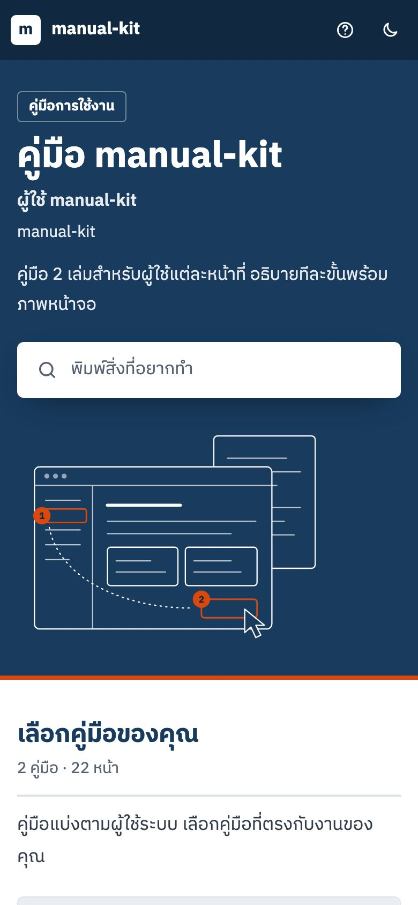

# manual-kit

ให้ **Claude Code** ทำ **คู่มือการใช้งานระบบแบบทางการ** สำหรับส่งลูกค้า ออกเป็น **PDF, Word และเว็บคู่มือ** พร้อม **ภาพหน้าจอ ภาพทีละขั้น และวิดีโอ** ที่ถ่ายจากระบบจริง

Claude อ่าน repo เอง → สแกน requirement / design / workflow / feature → เขียนสเปกคู่มือ → รันระบบด้วยข้อมูลทดสอบ → เขียนหน้า → ถ่ายภาพ → ออกไฟล์ → ตรวจผล
**คุณแค่สั่ง แล้วอ่านทวนก่อนส่งลูกค้า**

## ดูวิดีโอแนะนำ

วิดีโอ 1 นาทีครึ่ง: คำสั่ง, สเปกคู่มือ, PDF, Word, เว็บคู่มือ (ค้นหา, ภาพทีละขั้น, มือถือ, ธีมมืด), `manual-kit check` และวิธีติดตั้ง มีเสียงบรรยายภาษาไทยและคำบรรยายบนภาพ ภาพในวิดีโอมาจากคู่มือของ manual-kit เอง

[](docs/media/manual-kit-demo.mp4)

กดที่ภาพเพื่อเปิดวิดีโอ · ข้อความคำบรรยาย: [`docs/media/manual-kit-demo.th.vtt`](docs/media/manual-kit-demo.th.vtt) · วิธีทำวิดีโอนี้ใหม่: [`tools/demo`](tools/demo/README.md)

---

## ทำอะไรได้บ้าง

| ความสามารถ | รายละเอียด |
|---|---|
| **สแกนระบบเอง** | อ่านเอกสาร requirement / design (SRS, SDDS, PRD, README…) และโค้ด: หน้าจอ, บทบาท/สิทธิ์, ฟอร์ม, ข้อความแจ้งเตือน, สถานะของงาน, API, feature flag |
| **เขียนสเปกคู่มือ** | `manual-spec.md`: ผู้ใช้, ฟีเจอร์ทั้งหมด, workflow ตั้งแต่ต้นจนจบ, กฎทางธุรกิจ, แผนหน้าคู่มือ, คำถามที่ต้องยืนยัน — ทุกข้อบอกไฟล์ต้นทาง |
| **คู่มือ PDF ทางการ** | ปก, ข้อมูลเอกสาร, ประวัติแก้ไข, หน้าอนุมัติ, สารบัญมีเลขหน้า, สารบัญภาพ, หัว-ท้ายกระดาษ "หน้า X จาก Y", ฟอนต์ไทย |
| **ไฟล์ Word** | ภาษาไทยถูกต้องใน Microsoft Word (ฝังฟอนต์, ตัดคำไทย), สารบัญ, แก้ไขต่อได้ |
| **เว็บคู่มือ** | แถบบนสีแบรนด์, เมนูซ้าย, ค้นหาภาษาไทย, "ในหน้านี้", ใช้บนมือถือได้, ดาวน์โหลด PDF/Word |
| **ภาพจากระบบจริง** | ภาพหน้าจอพร้อมกรอบแดงชี้จุดที่ต้องกด, ภาพทีละขั้นพร้อมเลข, ปิดบังข้อมูลส่วนตัว |
| **วิดีโอสั้น** | อัดจากระบบจริง มีคำบรรยายบนภาพ + เพลงประกอบ (ไม่มีเสียงพากย์) |
| **ตามระบบเมื่อโค้ดเปลี่ยน** | บอกได้ว่าหน้าไหนต้องแก้, ชื่อปุ่มไหนเปลี่ยน, หน้าจอใหม่ไหนยังไม่มีคู่มือ — ใช้ใน CI ได้ |
| **รายงานปัญหาของระบบ** | ระหว่างทำคู่มือ Claude จะแจ้งสิ่งผิดปกติที่เจอ (ปุ่มทดสอบหลุด, ข้อความผิด, ข้อมูลจริงในระบบ) |

## ตัวอย่างผลลัพธ์

ภาพตัวอย่างมาจากคู่มือของ manual-kit เอง (`docs/manual/`) ซึ่งทำด้วย manual-kit

**PDF ทางการ** (ปก, ข้อมูลเอกสาร, สารบัญ, เนื้อหาพร้อมภาพหน้าจอและคำบรรยาย)



**เว็บคู่มือ** บนจอคอมและบนมือถือ (เมนูซ้าย, ค้นหา, ในหน้านี้, ภาพทีละขั้น)

 

**สเปกคู่มือ** ที่ Claude เขียนจากการสแกน repo: ดูตัวอย่างเต็มที่ [`docs/manual/manual-spec.md`](docs/manual/manual-spec.md)
(สเปกของคู่มือ manual-kit) ข้างล่างเป็นตัวอย่างจากระบบลางานสมมติ

```text
## 4. รายการความสามารถ (feature inventory)
| # | ความสามารถ   | ทำอะไร                                  | ใครใช้      | หลักฐาน                        |
| F2 | ยื่นใบลา      | ประเภทการลา วันที่ เหตุผล แนบไฟล์             | พนักงาน     | src/pages/LeaveForm.tsx:40-88  |
| F5 | อนุมัติใบลา    | อนุมัติ หรือไม่อนุมัติพร้อมเหตุผล               | หัวหน้างาน   | src/pages/Approvals.tsx:112    |
## 5. ขั้นตอนการทำงานตั้งแต่ต้นจนจบ
  1. พนักงานกด "ยื่นใบลา" เลือกประเภทและวันที่ … (LeaveForm.tsx:40-61)
  2. หัวหน้างานได้รับแจ้งและเปิดรายการรออนุมัติ … (Approvals.tsx:90-118)
- สถานะ: draft → submitted → approved / rejected
```

## ขั้นตอนการทำ (ภาพรวม)

```text
 คุณ                         Claude + manual-kit
 ─────────────────────────   ──────────────────────────────────────────────────────────────
 /manual ทำคู่มือผู้ใช้ …    1. อ่าน repo + สแกน (discover)        → manual/discovery.md
                             2. เขียนสเปกคู่มือ                    → manual/manual-spec.md
 (อ่านสเปกได้ ถ้าต้องการ)    3. รันระบบในเครื่องด้วยข้อมูลสมมติ
                             4. เขียนหน้า                          → manual/pages/
                             5. ถ่ายภาพ / ภาพทีละขั้น / วิดีโอ     → manual/media/
                             6. ตรวจ (check) + ออกไฟล์             → manual/dist/ (PDF, Word, เว็บ)
                             7. เปิดดูผลเอง แล้วรายงาน: ไฟล์, (รอระบุ), ปัญหาของระบบ
 อ่านทวน → กรอก (รอระบุ)
 → รับรอง → ส่งลูกค้า
 ระบบเปลี่ยน → /manual update  แก้เฉพาะหน้าที่กระทบ ถ่ายภาพใหม่เฉพาะที่เปลี่ยน
```

**เวลาโดยประมาณ** (จากการทดสอบจริง): คู่มือ 3 หน้าพร้อมภาพ + PDF + Word + เว็บ ราว 15–20 นาที · อัปเดตเมื่อระบบเปลี่ยน ไม่กี่นาทีต่อหน้า

---

## 1. ติดตั้ง (ครั้งเดียวต่อเครื่อง ~3 นาที)

```bash
claude plugin marketplace add https://github.com/nathawat/manual-kit.git
claude plugin install manual-kit@manual-kit
```

แล้วพิมพ์ `/reload-plugins` ใน Claude Code ที่เปิดอยู่ (หรือเปิด Claude Code ใหม่) คำสั่ง `/manual` และ skill จะยังใช้ไม่ได้จนกว่าจะ reload

- ต้องมี **Node.js 22.17 ขึ้นไป** (`node -v`)
- ครั้งแรกที่ใช้ plugin จะติดตั้งเครื่องมือที่ต้องใช้เอง ไม่ต้องรัน npm/pnpm เอง: ดาวน์โหลด Chromium และ Chromium headless
  shell (เบราว์เซอร์สำหรับถ่ายภาพ) รวมราว 280 MB ใช้เวลาราว 1–5 นาทีแล้วแต่ความเร็วอินเทอร์เน็ต ทำครั้งเดียวต่อเครื่อง

---

## 2. ใช้งาน

เปิด Claude Code ในโฟลเดอร์โปรเจกต์ แล้วพิมพ์:

| ต้องการ | พิมพ์ |
|---|---|
| ทำคู่มือใหม่ | `/manual ทำคู่มือผู้ใช้ ภาษาไทย ออก PDF กับ Word` |
| ดูสเปกก่อน (ยังไม่เขียนคู่มือ) | `/manual spec` |
| ระบบเปลี่ยน ให้คู่มือตาม | `/manual update` |
| ตรวจว่าคู่มือยังตรงกับระบบไหม | `/manual check` |

(ถ้า `/manual` ไม่ขึ้น ใช้ชื่อเต็ม `/manual-kit:manual`) จะพิมพ์เป็นประโยคธรรมดาก็ได้ เช่น

```text
ทำคู่มือผู้ดูแลระบบ ภาษาไทย ออก PDF อย่างเดียว ลูกค้าคือ กรม... เลขที่เอกสาร XX-UM-001
ทำคู่มือเจ้าหน้าที่ พร้อมภาพทีละขั้นและวิดีโอ ออกเป็นเว็บด้วย
ฟีเจอร์อนุมัติเอกสารเพิ่งเปลี่ยน ช่วยอัปเดตคู่มือบทนั้น
```

### Claude จะทำอะไรบ้าง
1. อ่าน README / CLAUDE.md / docs ของโปรเจกต์
2. **สแกนระบบ** (`discover`): หน้าจอ, บทบาท/สิทธิ์, ฟอร์มและข้อความแจ้งเตือน, สถานะของงาน (workflow), API, feature flag, เอกสาร requirement/design ใน repo
3. **เขียนสเปกคู่มือ** `manual/manual-spec.md`: ผู้ใช้, ฟีเจอร์ทั้งหมด, workflow ตั้งแต่ต้นจนจบ, กฎและข้อจำกัด, แผนหน้าคู่มือ, คำถามที่ต้องยืนยัน — ทุกข้ออ้างอิงไฟล์ต้นทาง ไม่แต่งเอง
4. สรุปให้ดู แล้วทำต่อ (ยกเว้นสั่ง `/manual spec`)
5. รันระบบในเครื่องด้วย **ข้อมูลสมมติ** → เขียนหน้า → ถ่ายภาพ / ภาพทีละขั้น / วิดีโอ
6. ตรวจ → ออก PDF / Word / เว็บ → เปิดดูผลเอง → ปิดทุกอย่างที่เปิดไว้
7. รายงาน: ไฟล์ที่ได้, รายการ **(รอระบุ)** ที่ต้องกรอก, **ปัญหาของระบบที่เจอระหว่างทำ**, สิ่งที่คนต้องทำต่อ

---

## 3. สิ่งที่ควรเตรียม

- ระบบต้อง **รันในเครื่องได้** (README บอกวิธีรันยิ่งดี) — Claude สร้างข้อมูลทดสอบเอง **ไม่ใช้ production หรือข้อมูลจริงของลูกค้า**
- ข้อมูลเอกสาร (ถ้ามี): ชื่อลูกค้า, ชื่อโครงการ, เลขที่เอกสาร, เวอร์ชัน, ผู้อนุมัติ, ช่องทางติดต่อ — ถ้าไม่บอก จะเป็น `(รอระบุ)` ให้กรอกทีหลัง
- Claude จะ **ถามก่อนเสมอ** เมื่อ:
  - ต้องใช้ **API key ที่เสียเงิน** (เช่น ระบบที่เรียก AI) — บอกได้ว่าอนุญาตกี่ครั้ง
  - ต้อง **ติดตั้งโปรแกรม** เช่น `brew install pandoc` (ใช้ทำไฟล์ Word)
- PDF และเว็บใช้ได้ทันที · **LibreOffice** (ไม่บังคับ) ช่วยใส่เลขหน้าในสารบัญของไฟล์ Word

---

## 4. ผลลัพธ์อยู่ที่ไหน

ทุกอย่างอยู่ในโฟลเดอร์ `manual/` ของโปรเจกต์ — **commit ไว้กับโค้ด** (คู่มือจะตามโค้ดได้)

| ไฟล์ | คืออะไร |
|---|---|
| `manual/dist/*.pdf`, `*.docx` | คู่มือส่งลูกค้า |
| `manual/dist/web/` | เว็บคู่มือ (ไฟล์ static เปิด `index.html` หรืออัปโหลดขึ้นโฮสต์ไหนก็ได้) |
| `manual/manual-spec.md` | สเปกคู่มือ (ใช้คุยกับลูกค้า/ทีมได้) |
| `manual/discovery.md` | หลักฐานที่สแกนได้จากโค้ด |
| `manual/pages/` | เนื้อหาแต่ละหน้า (Markdown แก้เองได้) |
| `manual/media/` | ภาพและวิดีโอ |

---

## 5. ก่อนส่งลูกค้า (เช็กลิสต์)

- [ ] อ่านทุกหน้า แก้ `(รอระบุ)` ให้ครบ
- [ ] รับรองหน้า: หลังอ่านครบ พิมพ์ใน Claude Code ว่า `! manual-kit sign --all` (หรือระบุ id หน้า) — **คนเท่านั้นที่รับรอง Claude ไม่รับรองแทน**
- [ ] เปิด PDF ดูทุกหน้า
- [ ] เปิดไฟล์ Word ใน **Microsoft Word จริง** หนึ่งครั้ง (ตรวจฟอนต์ไทยและสารบัญ)
- [ ] ปัญหาของระบบที่ Claude รายงาน → แจ้งทีมพัฒนา อย่าเขียนลงคู่มือเหมือนเป็นฟีเจอร์

---

## 6. กติกา

- ถ่ายภาพจากเครื่องตัวเอง/staging ด้วยข้อมูลสมมติเท่านั้น ห้ามข้อมูลจริงของลูกค้าหรือบุคคล
- ห้ามใส่ password / API key ในไฟล์คู่มือ
- ไม่ใช้คำโอ้อวด ("ดีที่สุด", "อันดับ 1") — ระบบตรวจให้
- แก้ฟีเจอร์ไหน ให้สั่ง `/manual update` ใน MR เดียวกัน คู่มือจะไม่ตามหลัง

---

## 7. ปัญหาที่พบบ่อย

| อาการ | วิธีแก้ |
|---|---|
| `marketplace add` ไม่ผ่าน | ตรวจว่าที่อยู่ repo ถูกต้องและเครื่องต่ออินเทอร์เน็ตได้ (`git ls-remote <ที่อยู่ repo>`) |
| `/manual` ไม่ขึ้น | ใช้ `/manual-kit:manual` หรือ `claude plugin list` ดูว่าติดตั้งแล้ว แล้วเปิด Claude Code ใหม่ |
| ใช้ครั้งแรกช้า | กำลังติดตั้งเบราว์เซอร์สำหรับถ่ายภาพ (ครั้งเดียว 2–3 นาที) |
| Claude บอกรันระบบไม่ได้ | บอกวิธีรัน/ฐานข้อมูลที่ต้องใช้ หรือเพิ่มวิธีรันใน README ของโปรเจกต์ |
| ไฟล์ Word สารบัญไม่มีเลขหน้า | ติดตั้ง LibreOffice แล้วสั่งทำ Word ใหม่ หรือเปิดใน Word แล้วกดอัปเดตสารบัญ |
| อยากได้เวอร์ชันใหม่ของ plugin | `claude plugin update manual-kit@manual-kit` |

### อัปเดต plugin
```bash
claude plugin update manual-kit@manual-kit
```
หรือเปิดอัปเดตอัตโนมัติ: ใน Claude Code พิมพ์ `/plugin` → Marketplaces → manual-kit → Enable auto-update

รายละเอียดคำสั่ง, config, รูปแบบหน้า และ CI: [`docs/reference.md`](docs/reference.md)

---

## คู่มือของ manual-kit (ทำด้วย manual-kit เอง)

| เล่ม | ผู้อ่าน | PDF | Word | เว็บ |
|---|---|---|---|---|
| คู่มือการใช้งาน | ทีมที่ทำคู่มือ, หัวหน้าทีม / PM | [PDF](docs/manual/dist/user-guide.th.pdf) | [DOCX](docs/manual/dist/user-guide.th.docx) | [web](docs/manual/dist/web/user-guide/th/index.html) |
| คู่มือการพัฒนา | นักพัฒนา manual-kit | [PDF](docs/manual/dist/dev-guide.th.pdf) | [DOCX](docs/manual/dist/dev-guide.th.docx) | [web](docs/manual/dist/web/dev-guide/th/index.html) |

เว็บคู่มือทั้งชุดอยู่ที่ [`docs/manual/dist/web/`](docs/manual/dist/web/index.html) (เปิด `index.html` ในเครื่อง หรือ
`node dist/cli.js -m docs/manual preview`) · สเปก: [`docs/manual/manual-spec.md`](docs/manual/manual-spec.md) ·
หลักการวิศวกรรม: [`docs/engineering-principles.md`](docs/engineering-principles.md)

ตรวจว่าคู่มือยังตรงกับโค้ด: `node dist/cli.js -m docs/manual check` (หน้าที่ยังไม่มีคนรับรองจะแสดงในรายการ)

**เผยแพร่ขึ้น Outline wiki**: ตั้ง `outline: { baseUrl: https://wiki.example.com }` ใน `manual.config.yaml` แล้วดูแผนก่อนด้วย
`node dist/cli.js -m docs/manual publish outline --collection <id หรือ urlId> --dry-run` แล้วส่งจริงด้วยคำสั่งเดียวกันโดยไม่มี
`--dry-run` และตั้ง `OUTLINE_API_KEY` ในตัวแปรสภาพแวดล้อม

---

### สำหรับคนพัฒนา manual-kit

- โค้ด `src/` (TypeScript) · plugin `plugins/manual-kit/` · marketplace `.claude-plugin/marketplace.json`
- `pnpm verify` = typecheck + bundle + test + build · `pnpm bundle` สร้าง `plugins/manual-kit/dist/manual-kit.mjs` (commit ด้วย เทสต์จะ fail ถ้า bundle ไม่ตรงกับโค้ด)
- แพ็กเกจที่ไม่ bundle (playwright, pagedjs, typescript) ระบุใน `plugins/manual-kit/runtime/` ติดตั้งลง `~/.claude/plugins/data/manual-kit-manual-kit` ตอนเริ่มใช้
- skill: `plugins/manual-kit/skills/manual` (ขั้นตอน) และ `building-product-manuals` (กติกาและวิธีการ)
- ทดสอบ plugin โดยไม่แตะ config จริง: `CLAUDE_CONFIG_DIR=/tmp/x claude plugin marketplace add <repo path>` แล้ว `install`
- ทุกการแก้ต้องมีเทสต์ commit ทีละเรื่อง ดู `CHANGELOG.md` และ `docs/spec.md`
